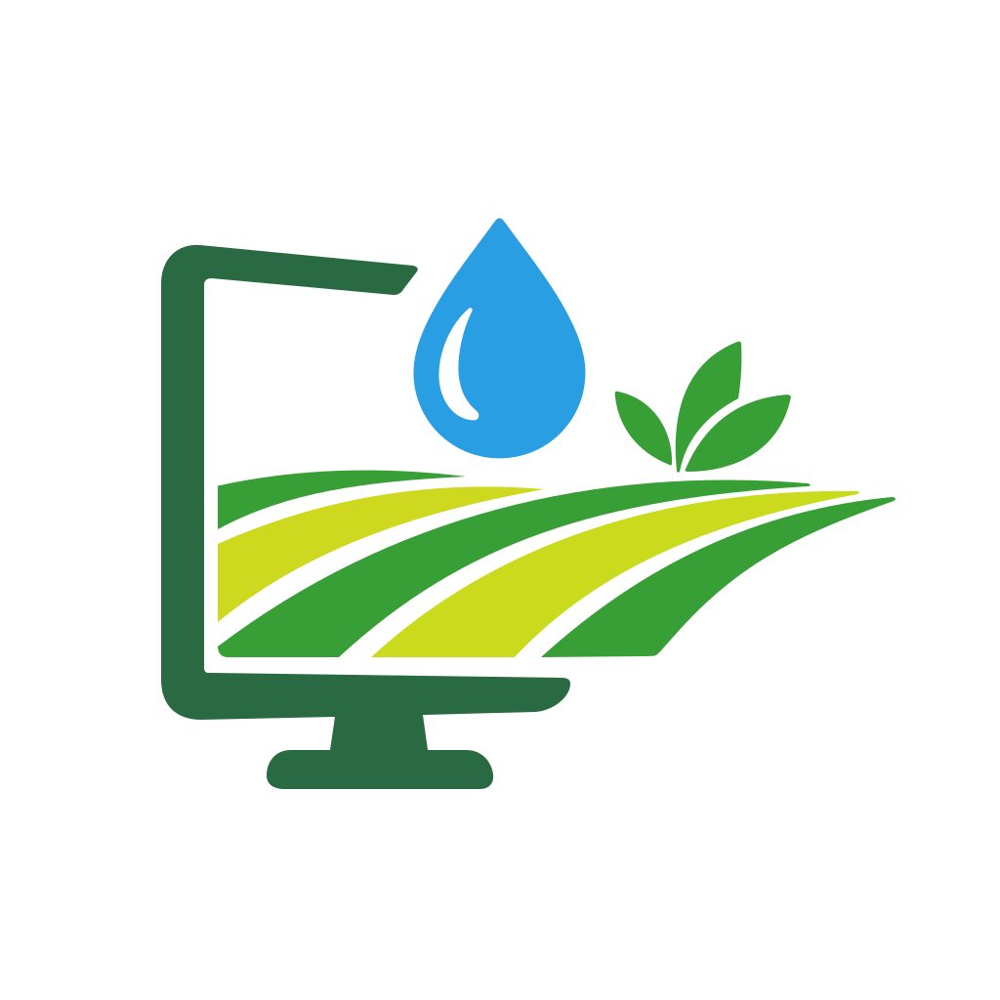
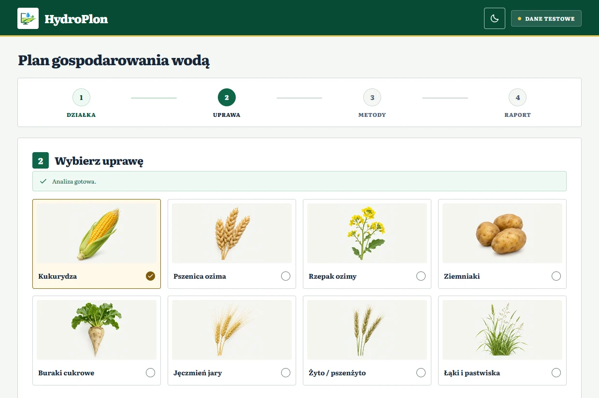

  

<h1 align="center">HydroPlon</h1>

Plan gospodarowania wodą dla działki rolnej

  <a href="docs/INSTALACJA.md"><strong>Instalacja i uruchomienie</strong></a> ·
  <a href="docs/INSTRUKCJA.md"><strong>Instrukcja obsługi</strong></a> ·
  <a href="docs/assets/hydroplon-przykladowy-raport.pdf"><strong>Przykładowy raport PDF</strong></a>

## Jak działa

1. **Działka** — wpisz adres lub identyfikator albo wskaż działkę na mapie. Ustaw datę analizy.
2. **Uprawa** — wybierz uprawę i uzupełnij opcjonalne informacje o drenażu oraz retencji.
3. **Metody** — przejrzyj rekomendacje i wybierz działania do uwzględnienia w planie.
4. **Raport** — sprawdź stan niedoboru wody, możliwe przyczyny i uzasadnienie działań. Dalej znajdziesz koszty, opłacalność, dofinansowania, plan prac oraz źródła i ograniczenia. Raport możesz pobrać jako PDF.

Kreator obsługuje klawiaturę, przekazuje komunikaty czytnikom ekranu i ma jasny oraz ciemny motyw.

## Szybki start

Na Windows z Pythonem 3.13 pobierz całe repozytorium i uruchom [`Uruchom HydroPlon.cmd`](Uruchom%20HydroPlon.cmd). Skrypt przygotuje środowisko i otworzy aplikację pod adresem [127.0.0.1:8000/app](http://127.0.0.1:8000/app). Polecenia dla macOS i Linux oraz uruchomienie na danych testowych opisuje [instrukcja instalacji](docs/INSTALACJA.md).

## Dane

W trybie rzeczywistym HydroPlon korzysta z danych GUGiK, SoilGrids, IMGW-PIB, Wód Polskich i Sentinel-2. Tryb testowy używa syntetycznych danych, na których można przejść cały kreator. [Dokumentacja techniczna](docs/DANE_I_WERYFIKACJA.md) opisuje architekturę, pochodzenie danych, warunki korzystania i sposób weryfikacji wyników.

Wyniki analiz są orientacyjne. Ceny w kosztorysie mają charakter demonstracyjny, a warunki i terminy wsparcia wymagają sprawdzenia w dokumentacji programu.

## Struktura repozytorium

| Katalog | Zawartość |
| --- | --- |
| [`docs/`](docs/) | Instalacja, instrukcja obsługi i grafiki dokumentacji |
| [`backend/app/`](backend/app/) | API FastAPI, źródła danych, obliczenia, raporty i pliki aplikacji |
| [`frontend/sass/`](frontend/sass/) | Style kreatora kompilowane do CSS |
| [`scripts/`](scripts/) | Skrypty uruchomienia, demonstracji i importu danych |
| [`tests/`](tests/) | Testy obliczeń, API i ścieżki od działki do raportu |
