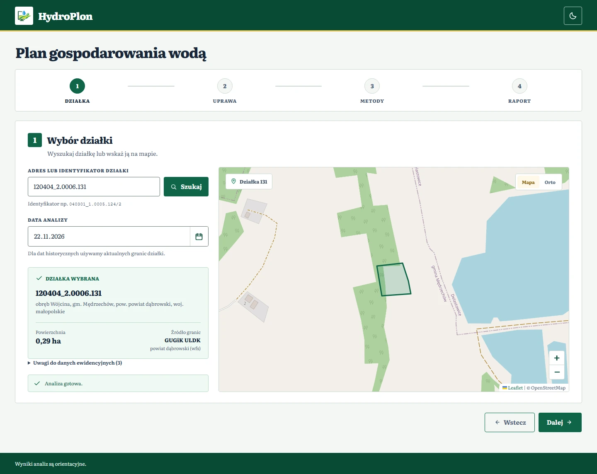
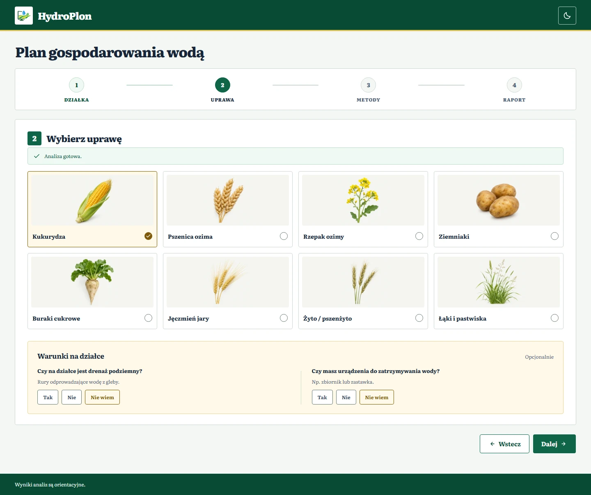
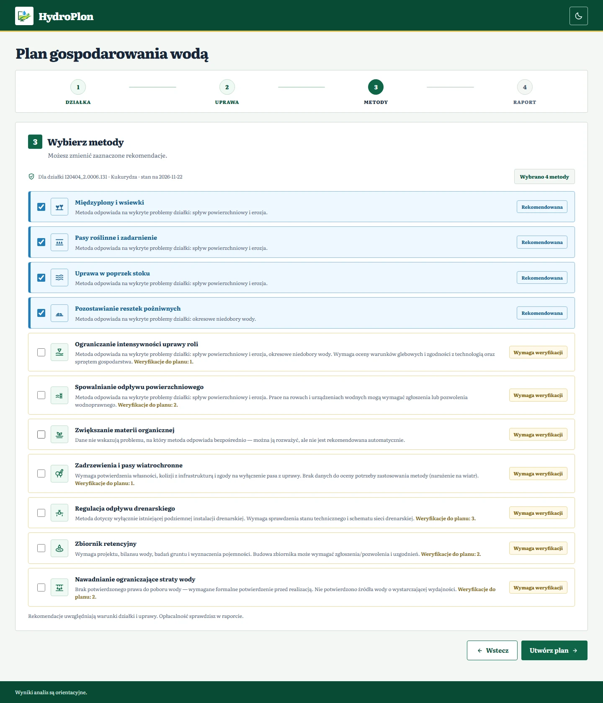
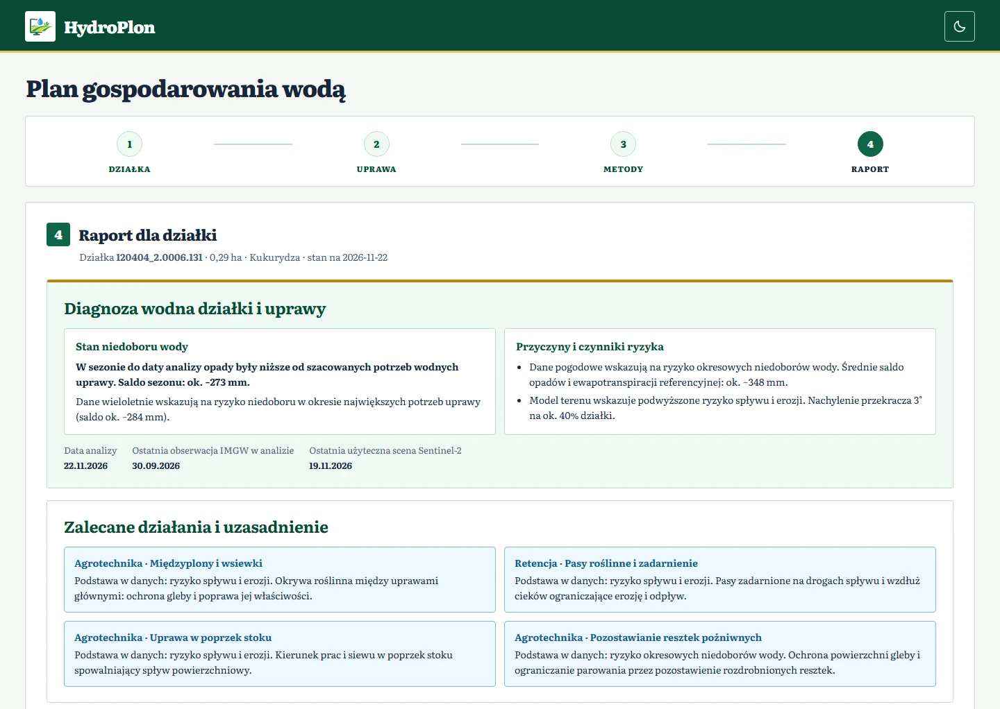
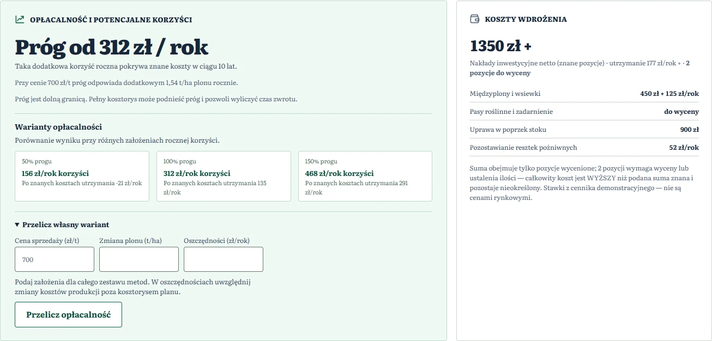
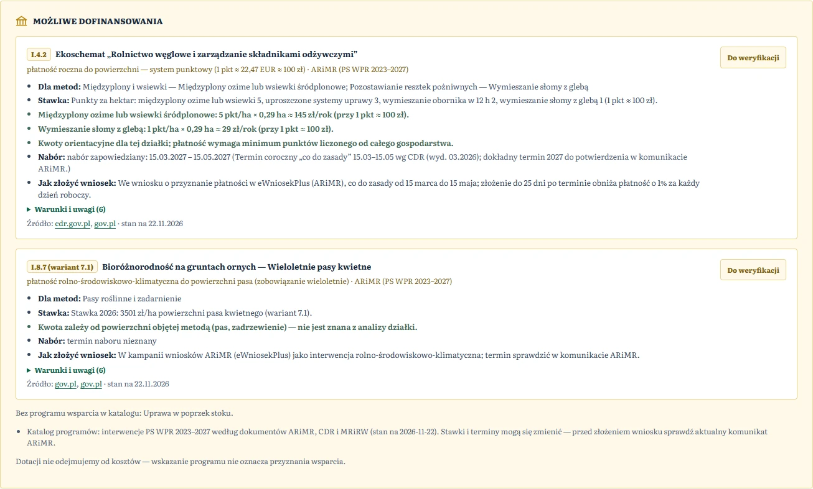
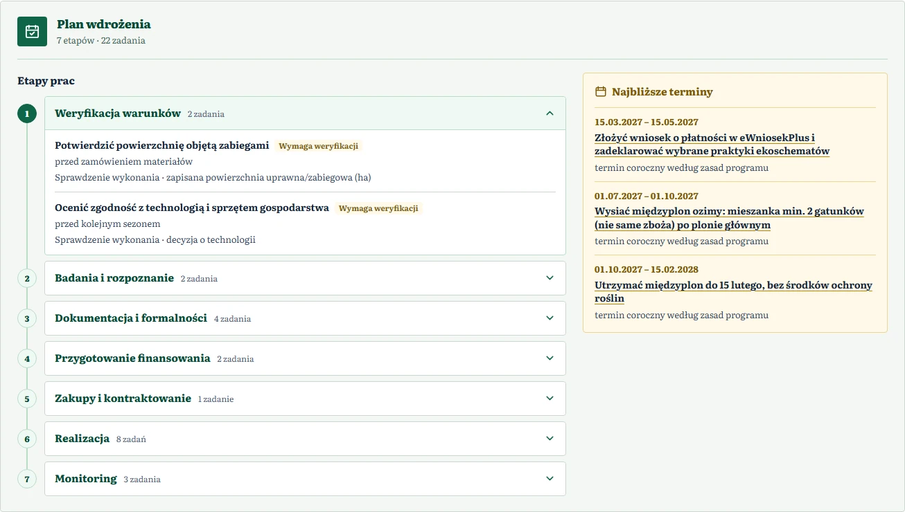
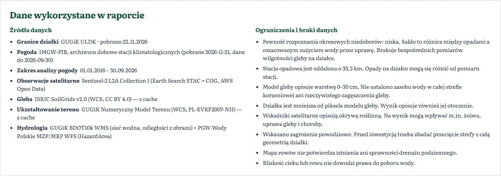

# HydroPlon w czterech krokach

[Strona projektu](../README.md) · [Instrukcja obsługi](INSTRUKCJA.md) · [Przykładowy raport PDF](assets/hydroplon-przykladowy-raport.pdf)

Zrzuty pokazują analizę kukurydzy na działce w Wójcinie. Kliknij obraz, aby otworzyć go w pełnym rozmiarze.

## 1. Działka

Wyszukaj adres lub identyfikator działki albo wskaż ją na mapie. Ustaw datę analizy.

## 2. Uprawa

Wybierz uprawę. Możesz dodać informacje o drenażu i urządzeniach retencyjnych.

## 3. Metody

Sprawdź uzasadnienia i wybierz działania, które mają trafić do planu.

## 4. Raport

Na początku raportu znajdziesz diagnozę, daty ostatnich obserwacji i zalecane działania.

Pozostałe części raportu

### Opłacalność i koszty

### Możliwe dofinansowania

### Plan wdrożenia

### Źródła i ograniczenia

